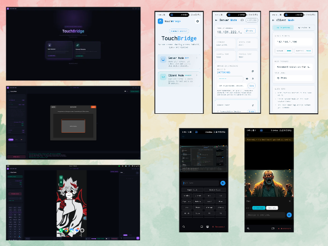
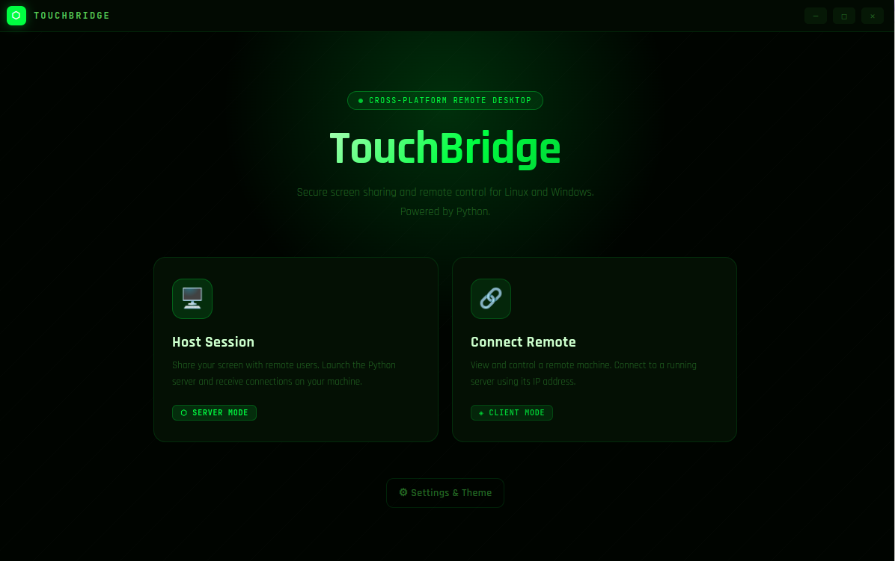
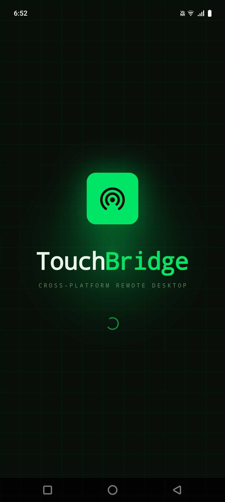
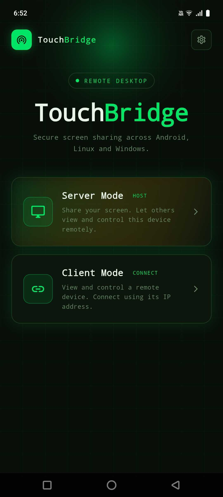
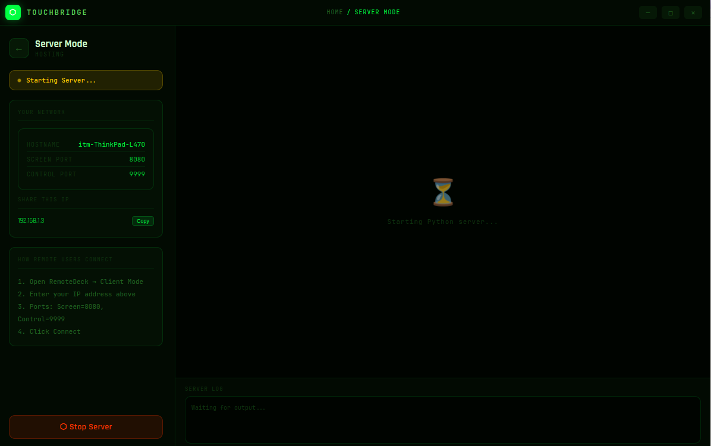
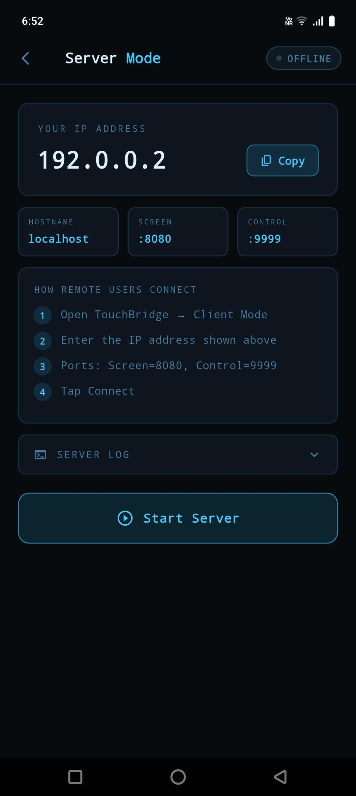
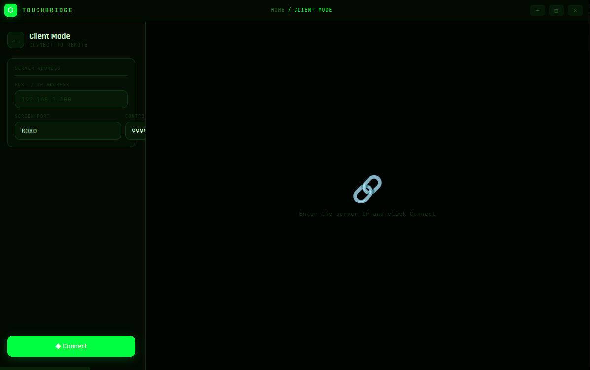
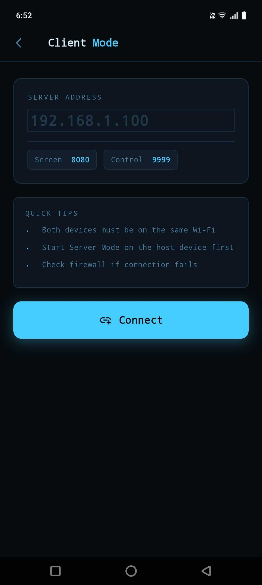
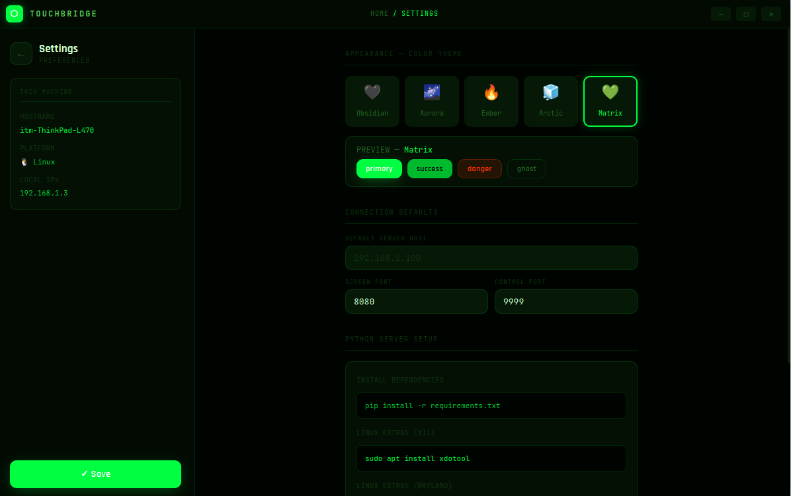
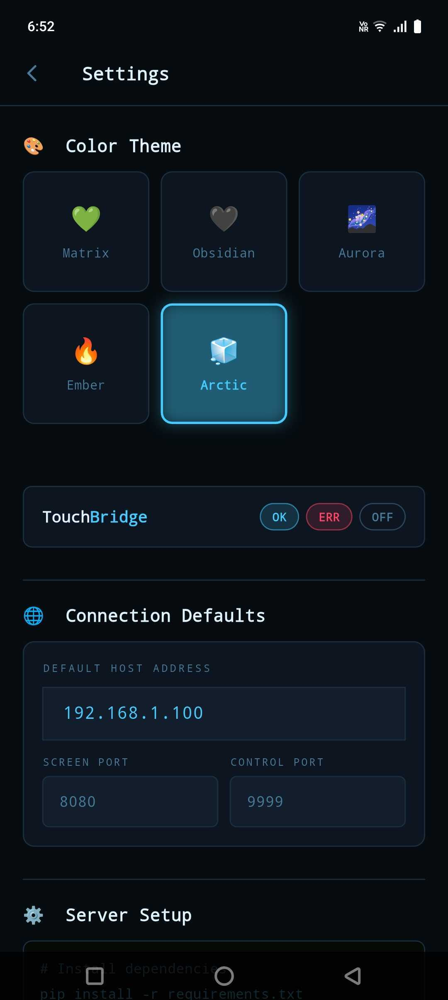

# ⬡TouchBridge
### Modern Cross-Platform Remote Desktop
**Electron · React · Python · Flutter**

> Secure screen sharing and remote control for Linux, Windows, and Android.

<center></center>

---

## Overview

TouchBridge is a secure, cross-platform remote desktop application that lets you share your screen and control remote machines over a local network. It combines a Python TCP server with an Electron/React frontend for desktop and a Flutter app for Android.

**Key Features:**
- Real-time screen capture streamed over TCP (H.264 by default, JPEG optional, port 8080)
- Remote input control — keyboard, mouse, and touch (port 9999)
- Dual roles: Host a session (Server Mode) or join one (Client Mode)
- 5 built-in color themes: Obsidian, Aurora, Ember, Arctic, Matrix
- Native input simulation: `xdotool` (X11), `ydotool` (Wayland), `pyautogui` (Windows)
  Connect phones, Linux machines, and Windows PCs together over a network
- One-click setup scripts for Linux and Windows

---

## Quick Start

### Linux / macOS
```bash
chmod +x start.sh && ./start.sh
```

### Windows
```bat
start.bat
```

---

## Remote input backends

| Host OS | Backend |
|---------|---------|
| Windows | `pyautogui` (native Win32 only as a fallback) |
| Linux X11 | native XTest helper → `pyautogui` |
| Linux Wayland | `/dev/uinput` via `python-evdev` (virtual mouse + keyboard) → ydotool script as fallback |
| Android | Accessibility Service in the Flutter app |

Wayland one-time setup: `sudo ./setup_uinput.sh`, then log out and back in. Keyboard input through uinput assumes a US layout.

---

## Video Codec (H.264 / JPEG)

Every device that can host (Windows, Linux, Android) has a **Video Codec** option in *Settings*: **H.264** (default) or **JPEG**. It applies to the stream *this* device sends when hosting, and can be switched live during a session. Viewing needs no setting — each frame is self-describing, so any device can watch either codec, including a mid-session switch.

- **Wire format** (port 8080, after `stream:<token>\n`): `[4-byte length][payload]`. A payload is a JPEG/PNG image, or an H.264 access unit: `"TBH4"` + 1 flag byte (bit 0 = keyframe) + Annex-B NAL units. Keyframes (every ~2 s) carry SPS+PPS in-band.
- **Desktop host**: Electron's WebCodecs `VideoEncoder` (`capture-window/h264-encoder.js`). If the machine has no usable H.264 encoder it falls back to JPEG automatically and logs it. Quality presets set max width + bitrate under H.264.
- **Desktop viewer**: WebCodecs `VideoDecoder` into a canvas (`src/h264Player.js`).
- **Android host**: hardware `MediaCodec` encoder fed by the MediaProjection display (`ScreenCaptureService.kt`); switching codec re-targets the display without a new permission prompt.
- **Android viewer**: `MediaCodec` decoder into a Flutter texture (`H264TextureDecoder.kt`).
- **Relay** (`server.py`): caches the current GOP so new viewers start at a keyframe; a viewer that falls behind skips to the next keyframe instead of corrupting the picture. JPEG viewers still get newest-frame-only.
- Android hosts now also serve the persistent `stream:` mode (previously only one-shot `capture:`), so Electron viewers get a continuous stream from them.

---

## Cross-Platform Connectivity

TouchBridge connects any combination of phones, Linux machines, and Windows PCs over a local network. Each platform has a dedicated native app:

| Platform | App |
|----------|-----|
| Windows  | Electron desktop app |
| Linux    | Electron desktop app |
| Android  | Flutter mobile app   |

### Supported Connection Scenarios

| Host → Viewer | Supported? |
|---------------|------------|
| Linux → Linux | ✅ Full support (X11 & Wayland) |
| Linux → Windows | ✅ View & control Linux from Windows |
| Windows → Linux | ✅ View & control Windows from Linux |
| Windows → Windows | ✅ Full support via pyautogui |
| Linux → Android | ✅ View & control Linux from Android (Flutter app) |
| Windows → Android | ✅ View & control Windows from Android (Flutter app) |
| Android → Linux | ✅ Host on Android, view/control from Linux |
| Android → Windows | ✅ Host on Android, view/control from Windows |
| Android → Android | ✅ Cross-device over shared Wi-Fi |

### Network Requirements
- All devices must be on the same local network (Wi-Fi or LAN)
- Host machine firewall must allow inbound on ports **8080** and **9999**
- No internet required — works fully offline on your local network
- Android users need the TouchBridge Flutter app installed
- For remote/cross-subnet access, use a VPN (e.g. Tailscale or WireGuard)

---

## Architecture

| Layer | Technology |
|-------|------------|
| GUI Frontend | Electron + React (`src/App.js`, `components/`) |
| Styling | CSS Themes (`src/App.css`) |
| Entry Point | `public/electron.js` — spawns Python, bridges IPC |
| Python Server | `python-server/server_2.py` — TCP on 8080 + 9999 |
| Input (X11) | `xdotool` |
| Input (Wayland) | `ydotool` |
| Input (Windows) | `pyautogui` |
| Mobile (Android) | Flutter app |

### Port Reference

| Port | Purpose |
|------|---------|
| 8080 | Screen capture — JPEG frames streamed over TCP |
| 9999 | Control channel — keyboard/mouse/touch commands |

---

## Linux Setup

### X11 (Most Desktop Environments)
```bash
sudo apt install xdotool
```

### Wayland (GNOME, KDE Wayland Sessions)
```bash
sudo apt install ydotool
sudo systemctl enable --now ydotoold
```

---

## Python Server Setup

```bash
cd python-server
pip install -r requirements.txt
```

---

## User Manual

### Home Screen

The Home screen is the main entry point of TouchBridge.

  

*Home Screen — choose Server Mode (Host) or Client Mode (Connect Remote) · Desktop (left) and Android (right)*

| Option | Description |
|--------|-------------|
| Host Session | Share your screen and accept incoming connections |
| Connect Remote | Connect to a running server by IP address |
| Settings & Theme | Configure ports, host defaults, and appearance |

---

### Server Mode (Hosting)

Server Mode turns your machine into a remote desktop host. The Python server starts automatically, captures your screen, and streams it to connected clients.

 

*Server Mode — monitor network info, server logs, and share your IP · Desktop (left) and Android (right)*

**Left Panel — Your Network Info:**
- **Hostname** — your machine's network name
- **Screen Port** — 8080 (video stream)
- **Control Port** — 9999 (input commands)
- **Share This IP** — your local IP with a Copy button

**How to Host a Session:**
1. Click **Server Mode** on the Home screen
2. Wait for "Starting Server..." to complete
3. Share your **Local IP** with the remote user
4. Instruct them to open TouchBridge → Client Mode and enter your IP
5. Click **Stop Server** when the session is done

---

### Client Mode (Connecting)

Client Mode connects to a remote TouchBridge server. Enter the host's IP and ports, then click Connect.

 

*Client Mode — enter the server IP and click Connect to start the remote session · Desktop (left) and Android (right)*

| Field | Value |
|-------|-------|
| Host / IP Address | Local IP of the machine running Server Mode |
| Screen Port | 8080 |
| Control Port | 9999 |

**How to Connect:**
1. Click **Client Mode** on the Home screen
2. Enter the server's IP address
3. Confirm ports are 8080 / 9999
4. Click **Connect** — the remote screen appears in the main panel
5. Use your mouse and keyboard to control the remote machine

---

### Settings & Preferences

 

*Settings — choose a color theme, set default ports, and view setup commands · Desktop (left) and Android (right)*

#### Color Themes

| Theme | Description |
|-------|-------------|
| 🖤 Obsidian | Dark neutral — classic black and grey |
| 🌌 Aurora | Deep blue-purple — cool northern lights palette |
| 🔥 Ember | Warm orange-red — high-contrast fire theme |
| 🧊 Arctic | Icy blue and white — clean minimal look |
| 💚 Matrix | Green on black — terminal hacker aesthetic (default) |

#### Connection Defaults
- **Default Server Host** — pre-fills the Client Mode IP field on launch
- **Screen Port** — default `8080`
- **Control Port** — default `9999`

---

## Project Structure

```
TOUCHBRIDGE/
├── electron-app/
│   ├── public/
│   │   ├── electron.js        # Main process — spawns Python, IPC
│   │   ├── index.html         # HTML shell
│   │   └── preload.js         # Secure context bridge
│   └── src/
│       ├── components/        # Reusable React UI components
│       ├── App.js             # Main UI — all screens & routing
│       ├── App.css            # Styles & theme variables
│       └── index.js           # React entry point
│
├── python-server/
│   ├── server_2.py            # Main TCP server (screen + control)
│   ├── server.py              # Legacy/alternate server
│   ├── requirements.txt       # Python dependencies
│   ├── start.sh               # Linux/macOS launcher
│   └── start.bat              # Windows launcher
│
└── flutter-app/               # Android mobile client
```

---

## Troubleshooting

| Problem | Solution |
|---------|----------|
| Server fails to start | Run: `pip install -r requirements.txt` in `python-server/` |
| Input not working (X11) | Install xdotool: `sudo apt install xdotool` |
| Input not working (Wayland) | Install & enable ydotool: `sudo systemctl enable --now ydotoold` |
| Can't connect from client | Check firewall — ports 8080 and 9999 must be open |
| Black screen on client | Confirm the server is fully started (check Server Log panel) |
| Wrong IP shown | Use the IP from the "Share This IP" field, not hostname |

---

## Themes

🖤 Obsidian · 🌌 Aurora · 🔥 Ember · 🧊 Arctic · 💚 Matrix

---

*⬡ TouchBridge — Secure Remote Desktop*
